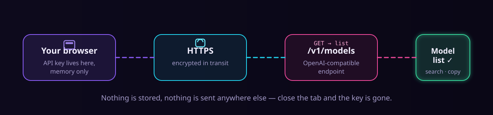

<div align="center">



[](https://keyscope.funapp.live)
[](LICENSE)
[](index.html)
[](#private-by-design)

**KeyScope is a tiny model explorer for your API keys.**
Paste a base URL and a key, and it lists every model that key can call — with instant search, one-tap copy, and JSON download. No signup, no backend, no tracking. The key never leaves your browser tab.

[Try it live →](https://keyscope.funapp.live)


</div>

## What it does

Got an API key from a relay or a model provider and wondering what it unlocks? KeyScope asks the standard `/v1/models` endpoint and shows you the answer in a clean, searchable grid:

- **Works with any OpenAI-compatible API** — RelayModels, zly168, OpenAI, or your own gateway. If it speaks `/v1/models`, KeyScope reads it.
- **Survives real-world quirks** — auto-retries with `/v1` when the base URL lacks it, and explains 401 / 403 / 404 / CORS failures with a `curl` fallback you can paste into a terminal.
- **Zero install** — it's one static HTML file. Host it anywhere or just open it.

<p align="center">

</p>

## Features

<p align="center">

</p>

- **Instant search & filter** — type a few letters, find the model.
- **One-tap copy & JSON download** — copy a single model ID, copy everything, or download the full response as JSON.
- **Key memory (optional)** — keep the key in `localStorage` for next time, or leave it off. Your choice, toggle in the UI.
- **Dark cosmic UI** — violet/pink/cyan aurora theme with a glowing mascot header.

## Private by design

<p align="center">

</p>

KeyScope is a single static page with **no server of its own**. Your key goes from the input field straight to the API you pointed it at — over HTTPS, from your browser. Nothing is stored on any server, because there is no server. Close the tab and the key is gone (unless you switched on the optional local remember toggle, which keeps it in your own browser only).

## Run it yourself

```sh
git clone https://github.com/mymyanmarland/keyscope.git
cd keyscope
# then open index.html, or serve it statically:
python3 -m http.server 8080   # → http://localhost:8080
```

That's it. No build step, no dependencies.

## Built with

Plain HTML + CSS + JavaScript. Fonts: Baloo 2, Inter, JetBrains Mono, Noto Sans Myanmar. Mascot logo generated for the project.

## License

MIT — see [LICENSE](LICENSE). Built by [Kyaw Myo Naing](https://github.com/mymyanmarland) / Funapp.
